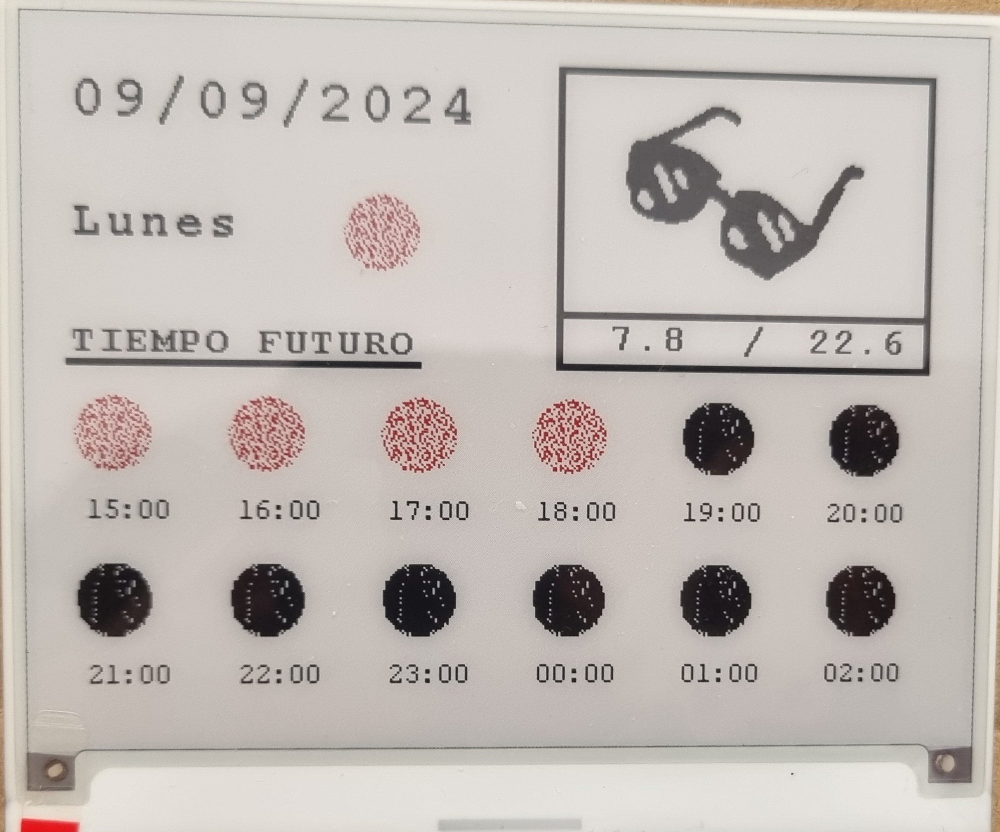
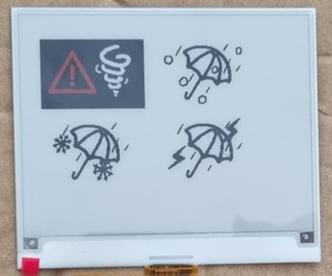
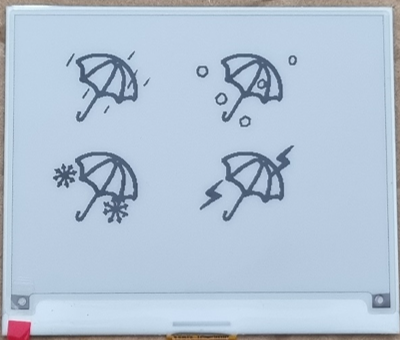
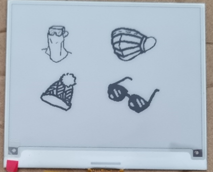
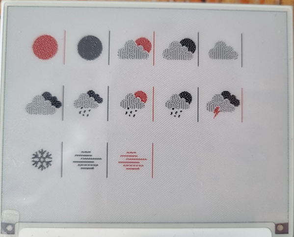
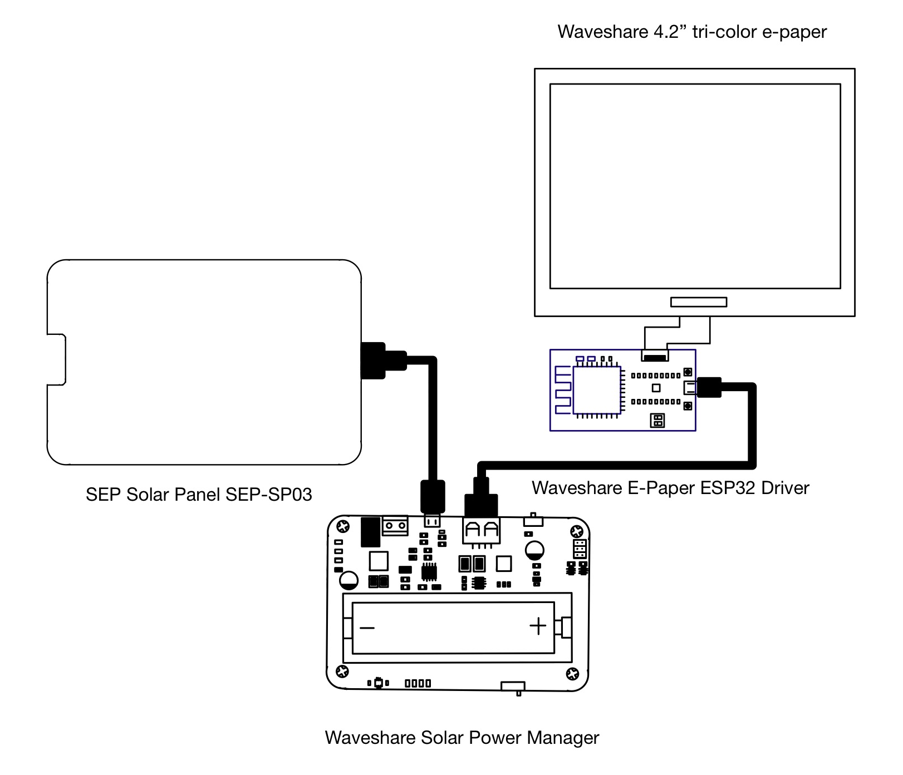
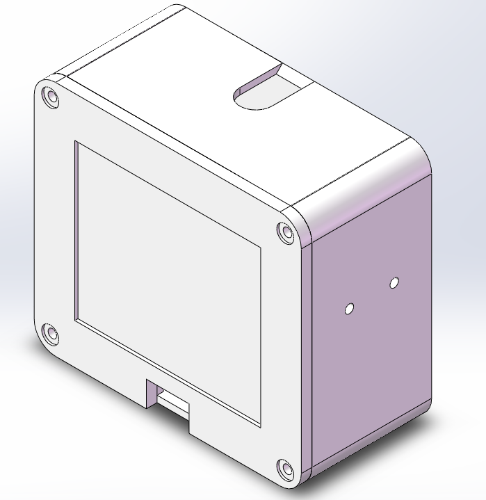
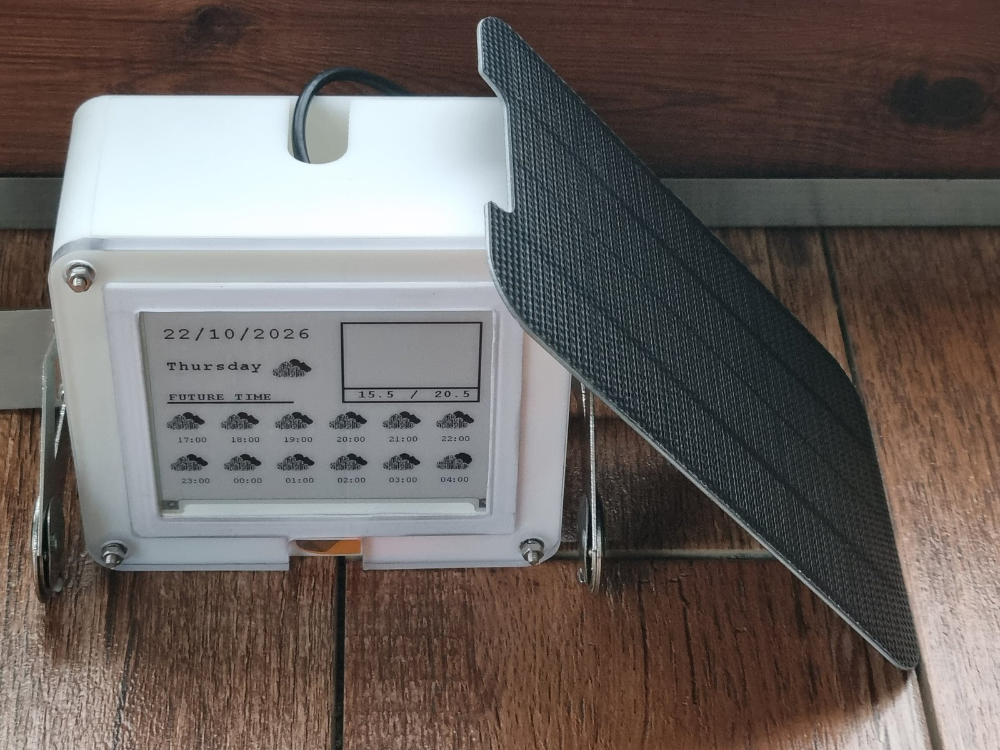

# E-Paper Weather Station (ESP32 + 4.2" Tri-Color E-Ink Display)



A low-power e-paper weather terminal built on the architecture of
[G6EJD's ESP32-e-Paper-Weather-Display](https://github.com/G6EJD/ESP32-e-Paper-Weather-Display).
• Wakes up once an hour, fetches the current weather and the next 12 hours from a weather API,
draws them on a 4.2-inch black/white/red e-paper panel, then goes into deep sleep, with signature feature telling you what to bring based on the forecast.
• Whole board runs on solar power and keeps going long-term without being recharged.

This project is my undergraduate thesis work. Code and system design were completed and
running in September 2024; enclosure was designed, machined and installed in October 2026.

**Language: C++** — written for the ESP32 under the Arduino framework, compiled as C++11.
A handful of pure-C source files hold the bitmap font data.

## Features

- **Current conditions**: date, weekday, high/low temperature, one weather icon about the weather for the current hour, twelve weather icons about the weather for future hours, and one advice icon telling you what to carry.

  **Advice icons** (left to right, top to bottom):

  

  *Stay at home — rain and hail, bring an umbrella — rain and snow, bring an umbrella — rain and lightning, bring an umbrella*

  

  *Rain, bring an umbrella — hail, bring an umbrella — snow, bring an umbrella — lightning, bring an umbrella*

  

  *Wear a face shield — wear a mask — bring a wool hat — wear sunglasses*

  If the place is blank, it means you don't need to bring anything.

- **Next 12 hours**: 2 rows x 6 columns, each cell shows the time and a weather icon.

  

  Thirteen weather states are covered: clear day, clear night, few clouds by day, few clouds at
  night, cloudy day or night, overcast day or night, heavy rain day or night, rain by day,
  rain at night, lightning day or night, snow day or night, fog day or night, sandstorm day or night.

- **Tri-color display**: black, white and red. Red marks some daytime conditions and highlights special weather alerts
- **Multilingual UI**: Chinese / English / Spanish
  - The Chinese UI uses a custom **Source Han Serif Bold 32x32** bitmap font
- **Switchable data sources**: one line at compile time, both are implemented
  - `Open-Meteo` (default, HTTPS with certificate pinning, no API key required)
  - `OpenWeatherMap` (HTTP, requires your own API key)
- **Deep sleep with drift compensation**: wakes on the hour, then compensates the next sleep duration by the measured offset, so the schedule never drifts
- **NTP time sync**: syncs on every wake-up and displays local time

## Hardware

| Part | Description |
| --- | --- |
| Controller | Waveshare E-Paper ESP32 Driver Board (`esp32dev`) |
| Display | Waveshare 4.2" tri-color e-paper, 400x300 (black/white/red) |
| Power | Waveshare Solar Power Manager + SANYO UR 14500AC (740 mAh) + SEP Solar Panel SEP-SP03 (5 V, 1.2 A, [link](https://s.miravia.es/s.Z6kn3)) |



### Wiring

| Display | ESP32 GPIO |
| --- | --- |
| BUSY | 25 |
| RST | 26 |
| DC | 27 |
| CS | 15 |
| SCK | 13 |
| MOSI (SDA) | 14 |

These pins match the Waveshare ESP32 driver board. SPI is bit-banged, so you can reassign them
freely — but avoid GPIO 6-11 / 34-39 / 0-2-12-15.

**Every component must share a common ground.** Without it the BUSY line has no common voltage
reference, the controller reads it as permanently busy, and the panel never refreshes.

### Power wiring

Everything in the power path — the USB cable, the solar panel leads and the battery leads — must
be **rated for at least 2 A**.

Thin cable and low-current connectors have noticeably higher resistance. At 1–2 A the voltage
drop becomes large enough to cause symptoms that look like software bugs: random brownout resets,
WiFi that associates and then drops, or a charger that never reaches full charge. So please check that it is a charging cable rated 2 A or more, not a thin data-only lead.

## Enclosure

The enclosure consists of three parts. All three can be 3D printed.

| Part | Role | Material in the build |
| --- | --- | --- |
| Front plate | Carries, secures and protects the e-paper panel | Machined hardened PC board |
| Rear box | Houses the controller, battery board and wiring | Resin 3D print |
| Lid | Closes the rear box; a 3 mm plate with a cable pass-through slot | Resin 3D print |

Assembled size: **125 × 111 × 56 mm**, excluding the solar panel.





The e-paper panel is fragile, so the front plate is machined from **hardened PC board** — flatter
and more dimensionally stable than a print.

### Mounting the panel

The panel must never touch a hard surface directly. Three layers of foam tape go into the front
plate recess, in this order:

1. **Front face of the plate** (the surface facing the panel's front): a ring of **8 mm wide x 0.5 mm thick**
2. **Recess side walls** (where the panel edges sit): a ring of **3 mm wide x 5 mm thick**
3. **Behind the panel** (inside the recess): one pad of **91 x 77 x 1.5 mm**

Each layer does a different job. Layer 3 pushes the panel forward and compresses the cushion in
layer 1; layer 2 locates the panel laterally so it cannot shift. That way the front, the edges and
the back of the panel are all separated from hard material by foam.

### Fastening and installation

- The front plate and the rear box are held together by **4 x M3 x 14 screws** through clearance holes
- Both sides of the rear box have mounting holes for wall mounting or a bracket

> For permanent outdoor installation, keep in mind that resin parts yellow and embrittle under UV.
> Printing the rear box and lid in PETG or ASA is a reasonable alternative.

### Model files

| File | Description |
| --- | --- |
| [`front-plate.STL`](hardware/enclosure/front-plate.STL) | Front plate, ready to slice |
| [`rear-box.STL`](hardware/enclosure/rear-box.STL) | Rear box, ready to slice |
| [`lid.STL`](hardware/enclosure/lid.STL) | Lid, ready to slice |
| [`enclosure.STEP`](hardware/enclosure/enclosure.STEP) | Full assembly with exact geometry, for editing |

All three parts can also be printed. In that case use a stiffer filament for the front plate
(PETG or ASA) and thicken it slightly.

Each part is exported in its own modelling orientation, so check that the largest flat face sits
on the build plate before slicing.

## Build and upload

1. Install [VS Code](https://code.visualstudio.com/) and the [PlatformIO extension](https://platformio.org/install/ide?install=vscode)
2. Open the project folder; PlatformIO downloads the dependencies automatically (`ArduinoJson@^7.1.0`)
3. Edit the configuration (see the next section)
4. Connect the board over USB and click PlatformIO **Upload**

Serial baud rate: `115200`.

## Configuration

All settings live in `src/setup_data.cpp`:

| Setting | Description |
| --- | --- |
| `ssid` / `password` | WiFi credentials — shipped as placeholders, fill in your own |
| `WxDataSource` | `WX_SRC_OPENMETEO` (recommended) or `WX_SRC_OWM` |
| `apikey` | OpenWeatherMap key — only needed when using `WX_SRC_OWM` |
| `LAT` / `LON` | Latitude / longitude |
| `TZ_OFFSET_SEC` / `Timezone` | UTC offset |
| `Language` | UI language: `"cn"` / `"en"` / `"es"` |
| `Units` | Unit system: `M` (metric) / `I` (imperial) |

`SleepDuration` and `WakeupTime` (sleep length in minutes, earliest hour to wake) live
at the top of `src/main.cpp`, not in this file.

Switch the data source by changing one line in `src/setup_data.cpp`:

```cpp
const int8_t WxDataSource = WX_SRC_OPENMETEO;   // or WX_SRC_OWM
```

## Project layout

```
src/
├── main.cpp               # main flow: connect -> fetch -> draw -> refresh -> sleep
├── setup_data.cpp/.h      # all user configuration
├── lang.cpp/.h            # UI string tables for the three languages
├── weather_source.cpp/.h  # data source dispatch layer
├── weather_openmeteo.cpp  # Open-Meteo implementation (HTTPS)
├── Rx_Store_inf.cpp       # OpenWeatherMap implementation + time conversion
├── GUI_Paint.cpp/.h       # drawing canvas (lines, rectangles, text, images)
├── output_image.cpp/.h    # weather code -> icon bitmap, with red tinting
├── fonts.h / font*.c      # Latin fonts + the Chinese bitmap font
├── certs.h                # ISRG Root X1 root certificate (used by Open-Meteo)
├── DEV_Config.cpp/.h      # bit-banged SPI and GPIO definitions
├── icon.cpp/.h            # weather icon bitmap data
└── utility/               # vendor display driver library
tools/                     # font generation, certificate fetch, layout preview scripts
hardware/enclosure/        # enclosure models (STL / STEP), assembly view and photo
```

## Custom Chinese font

`src/fontCN_zh.c` is generated from **Source Han Serif Bold** by `tools/gen_fontcn.py`, at 32x32,
1bpp, row-major, MSB first.

Only the 13 glyphs actually used by the UI are included:

```
未 来 天 气 星 期 日 一 二 三 四 五 六
```

**If you change any Chinese UI string, regenerate the font.** Otherwise the new character renders
blank — the draw function silently skips missing glyphs instead of reporting an error.

```bash
python tools/gen_fontcn.py     # edit CHARS in the script to add glyphs
```

The fonts the script needs are not committed to this repository. Download them into
`tools/fonts/` first:

- [Source Han Serif SC Bold](https://github.com/adobe-fonts/source-han-serif/releases) (SIL OFL)
- [Ma Shan Zheng](https://fonts.google.com/specimen/Ma+Shan+Zheng) (SIL OFL)
- [ZCOOL XiaoWei](https://fonts.google.com/specimen/ZCOOL+XiaoWei) (SIL OFL)

## Icons

All icons in this project — the 13 weather states and the 12 advice icons — are converted with
**Image2Lcd** into the bitmap format the e-paper driver can read directly.

Export settings used for every icon:

| Setting | Value |
| --- | --- |
| Output type | C array (`*.c`) |
| Scan mode | Horizontal scan (row-major) |
| Bits per pixel | 1 (monochrome) |
| Bit order | MSB first |
| Include image header | Yes (6 bytes) |

The generated data lives in `src/icon.cpp` and is declared in `src/icon.h`. Because the Image2Lcd
header is kept, call sites skip the first 6 bytes:

```cpp
Paint_DrawImage(&gImage_um1[6], x, y, w, h);
```

Two things to watch when adding or re-exporting an icon:

1. The `w` / `h` passed to `Paint_DrawImage` must match the real pixel size of the exported
   image, otherwise every row after the first shifts sideways.
2. Tri-color icons are exported **twice** — one bitmap for the black layer, one for the red layer
   (see the `*_b` / `*_r` pairs in `icon.h`). The two are drawn to separate framebuffers, so a
   pixel that should look red must be set in the `_r` bitmap and left blank in the `_b` one.

## Credits

- Built on the architecture of [G6EJD's ESP32-e-Paper-Weather-Display](https://github.com/G6EJD/ESP32-e-Paper-Weather-Display)
- Display driver based on the official Waveshare examples
- Font: [Source Han Serif](https://github.com/adobe-fonts/source-han-serif) (SIL Open Font License)
- Weather data: [Open-Meteo](https://open-meteo.com/) / [OpenWeatherMap](https://openweathermap.org/)
  - Open-Meteo data is licensed under CC BY 4.0; please credit "Weather data by Open-Meteo.com"
